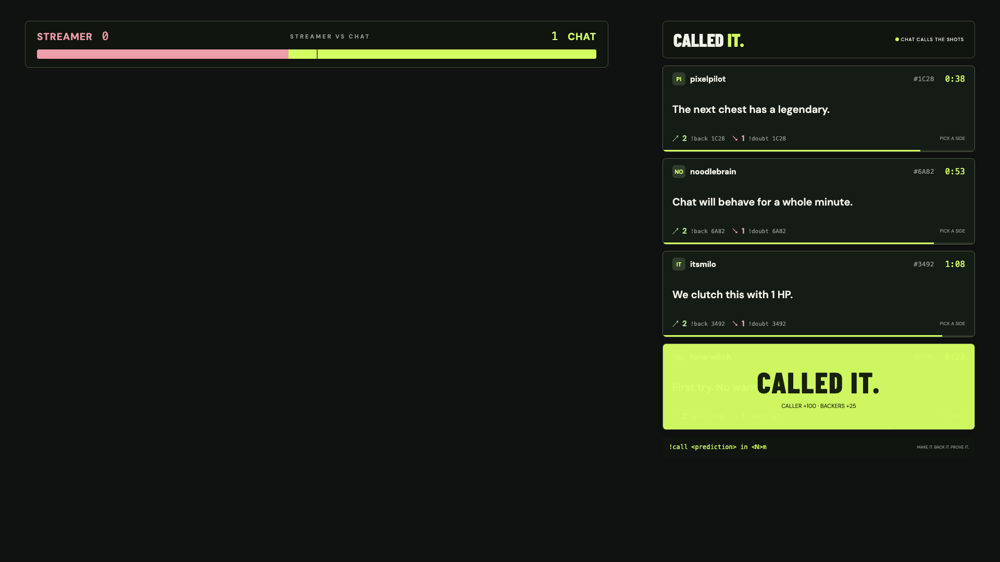
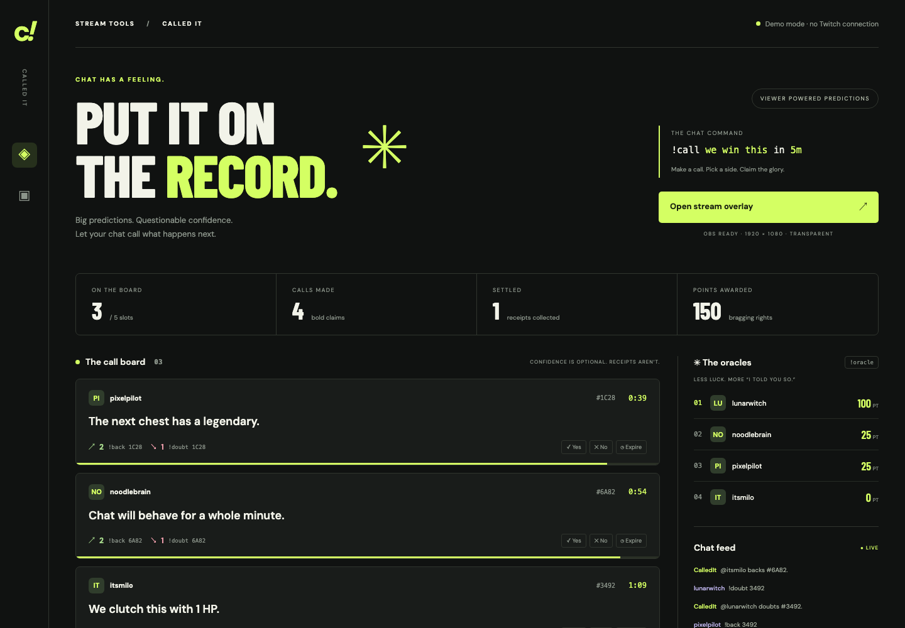

# Called It

**Let your chat call what happens next.** Viewers type `!call we clutch this in 5m`, everyone else backs or doubts it, and a mod settles it with `!yes` or `!no`. Right calls earn points, streaks earn a flame, and a live Streamer vs Chat bar keeps score of who really knows the game.

A local Twitch chatbot plus a transparent OBS overlay in one process. Node.js + Express + ws; no build step, no database, no cloud account. Runs on the streamer's own machine and never sends credentials to the browser.



## What it does

- **Predictions in chat.** `!call <prediction> in <N>m` opens a card with a countdown; five slots, one live call per viewer.
- **Pick a side.** `!back` and `!doubt` count live on the card; switch sides any time before the deadline.
- **Receipts.** A mod rules `!yes` or `!no`. The caller gets +100, the right side +25, the wrong side loses nothing. Expired calls pay nobody.
- **Moments.** Each ruling plays a full-card CALLED IT. or BUSTED. takeover on the overlay, with confetti and a short sound.
- **Streaks.** Three correct calls in a row put a 🔥 badge on the caller's next card.
- **Streamer vs Chat.** A persistent bar at the top of the overlay tracks how often chat was right versus wrong.
- **Oracles.** `!oracle` posts the top five; the overlay shows the leaderboard whenever the board is empty.
- **Survives restarts.** Calls, deadlines, votes, and scores are saved to a JSON file; overlays reconnect on their own.



## Try it without going live

Install Node.js 20 or newer, then:

```sh
npm install
npm run demo
```

Open **http://localhost:3000** for the prediction desk. Four fake viewers create calls, back/doubt, and a simulated mod resolves calls automatically. Demo time is accelerated: **1 prediction minute = 15 real seconds**. The dashboard includes a viewer selector and chat input, Yes / No / Expire controls on each card, and a button to fill empty slots. Use these to record specific animations. The simulation continues every 12 seconds; unresolved calls expire naturally. Close with Ctrl+C.

Open **http://localhost:3000/overlay** for the actual transparent overlay. The dashboard background is intentionally opaque; only `/overlay` is designed for OBS.

## Connect to Twitch

1. Register an application in the [Twitch developer console](https://dev.twitch.tv/console/apps). Keep its Client ID.
2. Follow the [Example Chatbot guide](https://dev.twitch.tv/docs/chat/chatbot-guide/) to obtain a **user access token for your bot account**, issued by that same Client ID, with `user:read:chat`, `user:write:chat`, and `user:bot` scopes. This uses the installed/local bot WebSocket flow, not an app access token. Never paste your token into chat or commit it.
3. Get the numeric Twitch user IDs for your channel and bot using [Get Users](https://dev.twitch.tv/docs/api/reference/#get-users). `BROADCASTER_ID` is the channel; `BOT_ID` is the account that owns the token. They may be the same account.
4. Copy `.env.example` to `.env` and fill in `CLIENT_ID`, `ACCESS_TOKEN`, `BROADCASTER_ID`, and `BOT_ID`.
5. Stop demo mode, then run `npm start`. Check the dashboard connection indicator and terminal. Chat commands work even when the channel is offline.

Token validation checks identity and read/write scopes at startup and hourly. Replace an expired/revoked token in `.env` and restart; automatic OAuth refresh is not implemented. Authentication errors are displayed without exposing the token.

The bot subscribes to `channel.chat.message` v1 via EventSub WebSocket and sends replies via the Send Chat Message API, following Twitch's guide. It handles keepalive timeouts, exponential reconnects, Twitch session migration, revocations, and duplicate notifications. Outgoing chat is queued at one message per 1.6 seconds, capped at 50 queued replies; gameplay updates immediately even if replies are delayed or dropped. Twitch doesn't replay messages lost during a network outage.

## OBS setup

1. Add a **Browser** source.
2. URL: `http://localhost:3000/overlay`
3. Width: **1920**, height: **1080**.
4. Keep default transparent browser-source CSS. No chroma key needed.

The board sits at the upper right with room for five cards. It scales proportionally in smaller browser previews. Keep the process running while recording. Overlay clients reconnect automatically and restore countdowns from server time. No Twitch credentials are sent to the browser. Google Fonts are optional; local font fallbacks work offline.

## Commands and rules

| Command | Effect |
| --- | --- |
| `!call we win the next round in 5m` | Create a prediction; bot replies with a four-character ID |
| `!back A1B2` | Back a prediction |
| `!doubt A1B2` | Doubt a prediction |
| `!yes A1B2` | Broadcaster/mod resolves as correct |
| `!no A1B2` | Broadcaster/mod resolves as busted |
| `!oracle` | Post the top five players |

Commands are case insensitive; `#A1B2` is also accepted. Calls last 1–180 whole minutes, with up to 180 characters of prediction text. One active call per Twitch user, five active calls total; additional calls are rejected with a chat explanation. One vote per user per call; switching sides is allowed until resolution/expiry. Callers cannot vote on their own calls.

A correct caller receives **100 points**. Each correct backer or doubter receives **25 points**. Incorrect sides lose nothing. Busted callers receive nothing. Resolutions are final and cannot award points twice. A mod or the broadcaster cannot resolve a call they made or voted on; another mod has to settle it, so nobody can award themselves points. At the deadline, calls become **unresolved** and cannot be resolved or voted on; no points are awarded. Results remain for eight seconds, then disappear. When the board is empty, the overlay displays the leaderboard. Active cards have display priority and the board never shows more than five cards, including outgoing results. Scores sort by points, then correct outcomes, then name.

## Persistence and local operation

Live data is saved atomically to `data/state.json`; demo data uses `data/demo.json`. Restarting retains calls, deadlines, votes, scores, and the latest 60 chat messages. Overdue calls expire on startup. Keep backups of the data directory. Invalid JSON stops startup instead of silently clearing scores. To reset demo/live state, stop the process and remove its corresponding JSON file. Use one process per state file; simultaneous writers are unsupported. Historical calls are retained in the file.

Optional `.env` settings: `PORT=3000`, `HOST=127.0.0.1`, `STATE_FILE=/absolute/path/to/state.json`. Demo loads `.env` too, but never contacts Twitch. The server binds to loopback by default. The demo controls exist only with `--demo`; live resolution is exclusively authorized from Twitch user IDs/badges. This is a local tool, not a public multi-user hosted service.

## Verification

```sh
npm test
```

Tests cover capacity, one active call per user, vote switching, self-vote rejection, authorization, both scoring outcomes, idempotent resolution, expiry, leaderboard ordering, and persistence. Live Twitch testing requires your own credentials.
